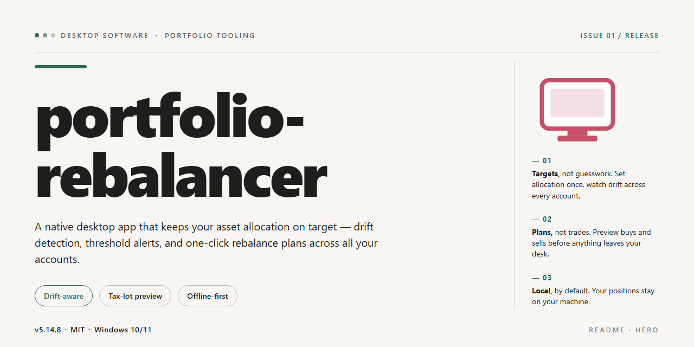

# Portfolio Rebalancer: Automated Asset Allocation Desktop Client for Windows 11

### 📦 PowerShell Install Button

   

---

Portfolio Rebalancer is a self-contained desktop application that ships as a pre-configured standalone build, eliminating dependency resolution and environment setup during deployment. The package bundles all required runtime components and default configuration profiles tuned for optimal performance on Windows x64 systems. Core capabilities include automated allocation analysis, threshold-based rebalance triggers, and deterministic portfolio drift calculations against user-defined target weights. The build is validated for offline installation, making it suitable for restricted or air-gapped workstation environments.

## ✅ Before You Start

- **OS:** Windows 10 / 11
- **Shell:** PowerShell 5.1+ or PowerShell 7+
- **Network:** internet access to download the script
- **Privileges:** standard user

## Features

- **Deterministic Rebalancing Engine:** Computes target allocations against current holdings using configurable drift thresholds, tolerance bands, and weighting modes, producing reproducible trade recommendations across runs.

- **Multi-Account Aggregation:** Consolidates positions across multiple portfolios and account types into a unified view, while preserving per-account constraints and tax-treatment boundaries during rebalance calculations.

- **Constraint-Aware Allocation:** Supports minimum and maximum position limits, asset-class caps, and locked holdings, ensuring generated recommendations remain within user-defined policy boundaries.

- **Configurable Drift Monitoring:** Tracks deviation from target weights at the position, asset-class, and portfolio level, with user-adjustable trigger thresholds that determine when a rebalance is flagged.

- **Local-First Data Model:** Stores portfolio definitions, target models, and historical snapshots in a local embedded database, eliminating dependency on external services and keeping all holdings data on the workstation.

- **Import and Export Pipelines:** Ingests positions from structured tabular files and emits rebalance reports in machine-readable and human-readable formats for downstream review or archival.

- **Scenario Simulation:** Applies hypothetical trades or market shifts to a portfolio snapshot and previews post-trade allocation drift before committing any changes.

- **Audit Trail and Snapshot History:** Records each rebalance event with timestamped inputs, computed targets, and generated recommendations, enabling side-by-side comparison of historical states.

- **Standalone Runtime:** Ships as a self-contained desktop application with all required dependencies bundled, requiring no external runtime installation or network access to operate.

- **Pre-Configured Defaults:** Delivered with sensible baseline parameters for thresholds, weighting schemes, and reporting output, allowing immediate use while remaining fully adjustable.

## How it works

portfolio-rebalancer operates as a self-contained local application that runs entirely on the desktop without requiring a server, cloud account, or network connection during normal use. The application is packaged with all runtime dependencies, configuration defaults, and supporting libraries already resolved, so the first launch proceeds directly into the working environment rather than an initialization wizard.

**Local-first architecture.** All portfolio data, target allocations, and rebalancing rules are stored in a local data directory created on first run. The application reads and writes exclusively to this location, keeping state isolated per installation and portable between machines through simple directory copying.

**Allocation model.** Users define holdings and target weights per asset or category. The engine computes current portfolio weights from stored quantities and prices, compares them against the configured targets, and derives the delta required to restore balance. Drift thresholds can be set per portfolio so that minor deviations are ignored until a configurable band is exceeded.

**Rebalancing workflow.** When a rebalance is triggered, the engine produces an ordered set of trade instructions that close the gap between current and target weights. The workflow supports both full rebalancing and partial, threshold-driven adjustments, and it reports projected post-trade weights before any changes are committed.

**Configuration and persistence.** Settings, portfolio definitions, and historical rebalance records are persisted in structured local files. The pre-configured defaults ship with sensible thresholds and formatting so the application is usable immediately, while every parameter remains editable through the local interface.

**Offline operation.** Because the build is standalone and pre-configured, no external services are contacted for core functionality. Price inputs are supplied manually or through imported local files, and all computation runs on the local machine, keeping portfolio data resident on the desktop at all times.

**Deterministic output.** Given the same holdings, targets, and inputs, the engine produces identical trade instructions across runs, which makes results reproducible for review and record-keeping. Each rebalance event is logged locally with its inputs and generated instructions for later inspection.

## Compatibility

The portfolio-rebalancer desktop application is distributed as a complete standalone build with no external runtime, package manager, or dependency resolution required at launch. The installer bundles all runtime components and pre-configured defaults, so the application operates fully offline after deployment.

**Operating System Support**

The build targets 64-bit desktop environments and is validated against current long-term-support releases of Windows, macOS, and mainstream Linux distributions. The installer detects the host architecture during setup and selects the appropriate binary set; no manual platform selection is required.

**Runtime and Dependencies**

All required libraries, service components, and configuration assets are packaged within the distribution. The application does not depend on a system-wide interpreter, package manager, or shared framework installation. Where a platform-native runtime is present, the bundled version is used in isolation to prevent version conflicts with existing system software.

**Hardware Baseline**

The application runs on standard desktop hardware without specialized acceleration. Memory and storage footprints are fixed at install time and documented in the build parameters; the standalone package reserves its full working set upfront to avoid runtime allocation failures.

**Configuration Portability**

Pre-configured performance profiles ship with the build and are applied automatically on first launch. User-level settings are stored in a dedicated application directory, allowing the installation to be relocated or backed up as a self-contained unit. No environment variables or system PATH modifications are required.

**Data and File Format Compatibility**

Portfolio data is read and written in the application's native format, with import compatibility maintained for standard tabular and structured data files. Format handling is versioned internally so that files produced by earlier builds remain readable after upgrade.

**Isolation and Coexistence**

The application installs into a self-contained directory and does not register global services or shared components. Multiple installed versions can coexist on the same machine, each retaining its own configuration and data scope, which supports side-by-side validation and rollback.

**Verification**

Each distributed build is checked against the documented platform matrix before release. Compatibility notes accompanying a given build identify the exact operating system versions and hardware baselines that were validated for that release.

## FAQ

### What does portfolio-rebalancer do?

portfolio-rebalancer is a standalone desktop application that analyzes current asset allocations against user-defined target weights and generates the trade actions required to restore balance. It operates entirely on local data, requires no external services, and ships pre-configured so it runs with default settings out of the box.

### Which platforms are supported?

The desktop build targets Windows x64. It is packaged as a self-contained executable with all runtime dependencies bundled, so no separate language runtime, package manager, or framework installation is required on the host machine.

### Does the application require network access?

No. portfolio-rebalancer is designed for offline operation. Portfolio inputs, target definitions, and rebalancing calculations are processed locally. Network connectivity is not needed for core rebalancing workflows.

### How are target allocations defined?

Targets are specified as weight percentages per asset or asset class. The application validates that targets sum to 100% before running a rebalancing pass and reports any discrepancy through the configuration panel. Multiple named target profiles can be stored and switched without restarting the application.

### What rebalancing methods are available?

The engine supports threshold-based rebalancing (triggering trades only when drift exceeds a configurable band) and full rebalancing (restoring exact target weights). Each method can be combined with a minimum trade size to avoid negligible adjustments.

### Where is configuration and portfolio data stored?

All configuration, target profiles, and portfolio snapshots persist in a local application data directory on the host system. No data leaves the machine, and the storage location is visible from the application's settings view for backup or migration purposes.

### Can allocation drift be previewed before applying trades?

Yes. Every rebalancing run produces a preview showing current weights, target weights, drift percentages, and the proposed trade list. Trades are only committed after explicit confirmation, allowing the output to be reviewed or exported first.

### How is compatibility with existing portfolio files handled?

Portfolio holdings can be entered manually or loaded from local structured data files. The application performs schema validation on load and surfaces clear error messages for malformed or incomplete records rather than silently discarding them.

### What are the performance characteristics of the standalone build?

The build is pre-configured for optimal performance on desktop hardware: calculations run in-process, startup is not gated on network calls, and rebalancing passes over typical portfolio sizes complete in well under a second. Memory footprint remains modest because no background services are installed.

### How are updates delivered?

Because the application is a standalone, self-contained package, updates are distributed as replacement builds. User configuration and portfolio data are preserved across replacements since they reside in the separate local data directory.

### Is administrative privilege required?

No elevated privileges are required for normal operation. The application runs per-user and writes only to user-scoped directories, making it suitable for locked-down desktop environments.

## Disclaimer

This standalone desktop build of portfolio-rebalancer is provided as a pre-configured, self-contained distribution intended for evaluation, testing, and deployment within controlled environments. The package includes all runtime dependencies and configuration defaults required to operate without external service calls, network synchronization, or third-party package resolution during execution. Users are responsible for verifying that the operating environment meets the documented compatibility requirements prior to deployment.

The software is supplied on an "as is" basis, without warranties of any kind, whether express, implied, or statutory, including but not limited to warranties of merchantability, fitness for a particular purpose, or non-infringement. No guarantee is made regarding uninterrupted operation, accuracy of rebalancing calculations, or suitability for any specific financial, regulatory, or production use case. Allocation outputs are computational results derived from user-supplied parameters and are not investment advice; all deployment decisions remain the sole responsibility of the operator.

By installing, executing, or otherwise using portfolio-rebalancer, the user acknowledges that they assume full responsibility for any outcomes arising from its use, including data loss, configuration drift, or misallocation resulting from incorrect inputs. The maintainers of this distribution accept no liability for direct, indirect, incidental, special, or consequential damages arising from the use or inability to use the software, even if advised of the possibility of such damages.

This build is distributed for legitimate testing and deployment purposes only. Redistribution, modification, or repackaging of the standalone bundle outside the terms defined in the accompanying License section is not permitted. Users are expected to maintain their own backups of configuration state and to validate rebalancing behavior against known reference cases before relying on the software in any operational context.

## License

This project is distributed under the MIT License, a permissive open-source license designed to maximize both personal and commercial usability while preserving attribution. The license grants unrestricted rights to use, copy, modify, merge, publish, distribute, sublicense, and sell copies of the software and its associated documentation, subject only to the conditions outlined below.

Under the terms of the license, the original copyright notice and this permission notice must be included in all copies or substantial portions of the software. This ensures that downstream users and redistributors retain full visibility into the origin and licensing terms of the codebase. The license imposes no restrictions on how the software is deployed, whether in private internal tooling, embedded within commercial products, or redistributed as part of a larger application suite. There are no royalty obligations, no per-seat licensing fees, and no usage caps tied to the grant.

The software is provided on an "as is" basis, without warranty of any kind, express or implied, including but not limited to the warranties of merchantability, fitness for a particular purpose, and noninfringement. In no event shall the authors or copyright holders be liable for any claim, damages, or other liability, whether in an action of contract, tort, or otherwise, arising from, out of, or in connection with the software or the use or other dealings in the software. Users are encouraged to review the full license text prior to redistribution to ensure compliance with the attribution requirement.

Because the project is delivered as a complete, standalone, pre-configured setup, no additional licensing steps, activation keys, or registration flows are required to operate the software within the scope of the grant. The build is self-contained, and the license terms apply uniformly to all bundled components unless a specific module carries its own compatible notice. Redistributors who modify the source are permitted to do so freely, provided the original notice remains intact and any substantial derivative works carry equivalent attribution.